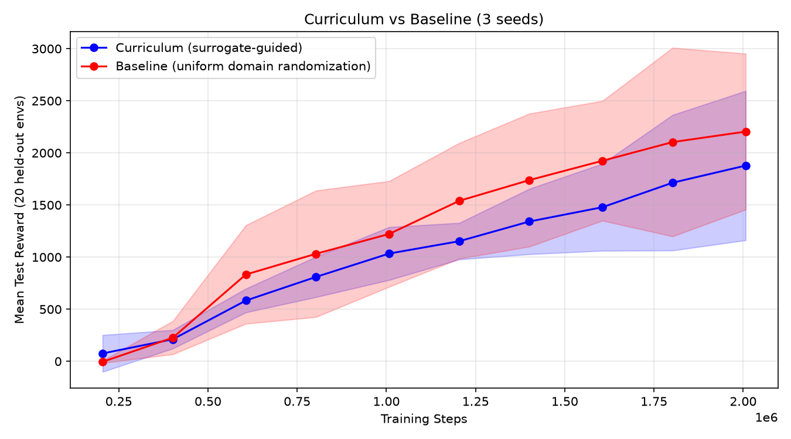

# Learned difficulty curricula go stale: a negative result on HalfCheetah

Can a learned difficulty predictor pick training environments that speed up RL?
I trained a surrogate to predict how a PPO policy will score on a HalfCheetah
variant (gravity, friction, torso mass), then used it to pick environments in a
"Goldilocks" band: not too easy, not too hard. **It did not beat uniform domain
randomization.** The logs show why: as the policy improved, its behavior moved
outside what the surrogate was trained on, and the surrogate stopped being usable.

## Setup

1. **Expert checkpoints.** PPO trained 1M steps on default physics, saved every 100k (10 checkpoints).
2. **Behavioral embedding.** Each policy is rolled out on 50 fixed probe environments,
   3 episodes each, giving a 150-D vector of `[mean reward, std reward, failure rate]` per probe.
3. **Surrogate.** An MLP maps (policy embedding, env params) to normalized reward.
   It was trained on 10k rollouts (1k random envs × 10 checkpoints), split by checkpoint
   (900k = val, 1M = test).
4. **Curriculum.** Every PPO rollout (8,192 steps, 4 envs), the policy is re-embedded,
   500 candidate envs are scored, and training uses envs whose predicted normalized reward
   is in [0.19, 0.24], roughly 580 to 850 raw reward. If the embedding's L2 norm is
   above 45 (the training checkpoints range from 6 to 17), the policy is marked
   out-of-distribution (OOD). **The surrogate is then skipped, and envs are sampled
   uniformly, the same as the baseline.**
5. **Baseline.** The same PPO, sampling envs uniformly at random.
6. **Evaluation.** Every ~200k steps, mean reward on 20 held-out random envs (matched
   per seed). 3 seeds, both arms trained from scratch.

## Results (2.0M env steps)

| Seed | Curriculum | Baseline | Curriculum active until |
|-----:|-----------:|---------:|:------------------------|
| 0 | 2289 | 1542 | ~1.0M (then OOD) |
| 1 | 2295 | 3016 | ~0.6M (OOD, briefly back at 0.8M, OOD from 1.0M) |
| 2 | 1051 | 2054 | the whole run (never OOD) |
| **Mean** | **≈1880** | **≈2200** | |



## What the logs show

- In seeds 0 and 1, the policy went OOD around 1M steps. After that, the "curriculum"
  arm was uniform randomization with a different start, and it ended up within the
  baseline's seed-to-seed spread.
- Seed 2 stayed in-distribution, so the surrogate picked environments for the whole run.
  It was the worst run: it plateaued near 1000 reward while its baseline reached 2054.
- In short, the surrogate only steered while its predictions were valid, and the one run
  where it steered throughout was the worst. With n=3 this is suggestive, not conclusive.

**Why it goes stale.** The surrogate saw only 10 distinct skill levels (8 in training),
all from policies trained on default physics. A policy trained on randomized physics
behaves differently on the probe set, so its embedding moves away from those 10 points.
Example: two failure-rate dims have std 0.1 in training, so solving one of those probes
moves the embedding by about 10σ. A fixed difficulty band also stops meaning "productive"
once the policy improves. It keeps choosing envs where the policy is predicted to score
around 700, which are the hardest ones.

## Limitations

- n=3 seeds; 1 episode per test env.
- Normalization stats for the surrogate are computed on all checkpoints, including the held-out ones (mild leakage).
- The env sampled for each training env is not logged, so the "pinned to hard envs" explanation for seed 2 is a hypothesis.

## Next experiments (predictions before running)

- Log the chosen env params in seed 2: I expect them to skew toward the hard end (strong gravity, heavy torso, low friction). ~70% confident.
- 10 seeds: I expect curriculum mean ≤ baseline mean. ~75% confident.
- Refitting the surrogate online on the policy's own rollouts should remove the OOD flip; it is unclear whether it then beats the baseline (~50/50).

## Reproduce

```bash
pip install "gymnasium[mujoco]" stable-baselines3 torch pandas matplotlib tqdm
python test_scripts.py                                # preflight checks
python curriculum_pipeline.py --phase dataset         # regenerates surrogate_training_data.csv from checkpoints/ (~2-4 h)
python curriculum_pipeline.py --phase surrogate
python curriculum_pipeline.py --phase run             # 3 seeds × (curriculum + baseline)
python curriculum_pipeline.py --phase plot
```

`checkpoints/`, `best_surrogate.pt`, `norm_stats.npz`, the per-seed logs, and the final
agents are included. `--phase train` retrains the expert checkpoints from scratch.

**Note on step counts.** The original run logged 2,048 steps per iteration, but PPO
collects a full 2048 × 4 = 8,192-step rollout per `learn()` call. The saved agents
confirm this: each has `num_timesteps = 2,007,040`. The code now counts real env steps.
The logs here were rescaled ×4, which matches exactly.
